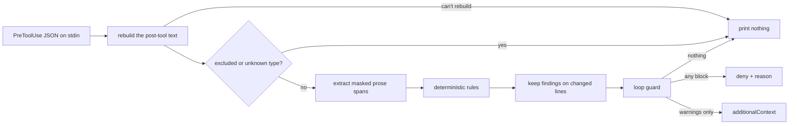

# voice-enforcer design

This doc owns how voice-enforcer works: the hook contract, prose extraction, the rule kinds and the ruleset format. The [README](../README.md) is the map and the CLI's `--help` owns flag details. Out of scope here (and in the code so far): LLM judges, `gh` interception and office formats, all tracked in the [backlog](../openspec/backlog.md).

## The pipeline

One path from text to findings, shared by `hook` and `check` so what CI reports and what the hook blocks can't drift apart. `check` is the same path minus diff scoping and the loop guard.



## The hook contract

`voice-enforcer hook` reads one PreToolUse payload and only acts on `Write`, `Edit` and `MultiEdit`; every other tool gets silence.

- **Pre, not Post.** A deny means nothing bad lands on disk, Claude gets the reason and retries in the same turn. PostToolUse can only complain after the write, and if Claude moves on the bad text stays. Pre's `additionalContext` carries warnings too, so there's no second hook.
- **Rebuilding the text.** For an Edit the hook applies `old_string` → `new_string` to the file on disk itself (unique match, or every match with `replace_all`; an empty `old_string` creates a missing file), MultiEdit applies its edits in order. When the rebuild can't proceed (no match, an ambiguous match, an unreadable or non-UTF-8 file) the hook passes through and lets the real tool report its own error, so the failure mode is a missed check, NEVER a wrong deny.
- **Only changed lines count.** A finding is reported when any of its lines is added or changed versus the file on disk (a new file is all changed). Judging the whole file was rejected because it blocks on tells Claude didn't write and loops forever on legacy files. The cost: rewriting one word on a line that already has a tell means fixing the tell too (arguably a feature).
- **Output.** Any blocking finding → `permissionDecision: "deny"` with every finding (blocks and warnings) in the reason. Warnings only → `additionalContext` and NO decision. Nothing → no output. The hook never emits `allow` or `ask`: `allow` skips the user's permission prompt, and a voice linter must never become a permission bypass.
- **Fail open, loudly.** Internal errors and garbage payloads exit 1 (Claude Code treats that as a non-blocking error) and never 2, since a broken enforcer that blocks every write bricks the session and the fix usually needs a write. A ruleset that exists but won't load comes back as `additionalContext` on every write so it can't be ignored; no ruleset at all is a silent pass.

Each finding names the rule id, severity, `path:line`, the matched text, the rule's message and its suggestion, enough for Claude to fix it without reading the ruleset.

### Loop guard

After `loop_guard.max_consecutive_blocks` denies in a row (default 3) on the same file in the same session, the next blocking evaluation comes back as warnings with a note that the guard tripped, and it stays tripped until an evaluation of that file has no blocking findings. A misfiring rule costs at most N retries.

State is one tiny file per (session, file) under `$XDG_STATE_HOME/voice-enforcer/sessions/` (default `~/.local/state/...`), written temp-then-rename. Claude Code runs parallel tool calls, so several hook processes can share a session; per-file state means they never contend. Session ids outside `[A-Za-z0-9_-]` get hashed instead of trusted as path components, and sessions untouched for 7 days get pruned.

## Prose extraction

Rules never see raw files, they see masked prose spans, each tagged with a register (`long_form` or `comment`), a comment level and a map back to source lines.

| Extension | Extractor | Register |
| --- | --- | --- |
| `.md`, `.markdown` | pulldown-cmark | long_form |
| `.txt` | paragraphs split on blank lines | long_form |
| `.rs`, `.swift`, `.ts`, `.tsx`, `.js`, `.jsx`, `.mjs`, `.cjs`, `.py`, `.sh`, `.bash`, `.zsh` | tree-sitter comment nodes | comment |

Anything else yields no prose (the backlog has more languages). A file whose first five lines say `@generated` or `DO NOT EDIT` yields nothing at all.

**Markdown.** One span per block (paragraph, heading, list item, table cell, quote). Code blocks, HTML blocks and front matter are skipped. Inline code, inline HTML and bare URLs become a placeholder (U+FFFC) that no phrase matches and that never ends a sentence; link text stays prose and link destinations don't. The file-link rule still reads the unmasked inline code and link targets.

**Code.** Only comments are prose (a string literal saying "leverage" is fine). Markers get stripped, consecutive own-line comments of the same style merge into one block (a `///` run and a `//` run stay separate), backtick-quoted code inside a comment is masked like markdown inline code and Python docstrings count as comments. Never prose: shebangs, blocks starting with `Copyright` or `SPDX-License-Identifier` and tool directives (eslint, `@ts-`, swiftlint, noqa, `type: ignore`, shellcheck, prettier, biome, rustfmt, pylint, `fmt: off`, NOLINT, istanbul, c8, clang-format, `#region`, plus your own `comment_directives`).

**Comment levels**, checked in this order:

1. **module**: Rust inner docs (`//!`, `/*!`) and a Python module docstring
2. **item**: an own-line block ending on the line directly above a declaration (attributes and decorators in between are fine), plus class and function docstrings. Declarations are functions, methods, types, enum variants, fields, traits, protocols, interfaces, impls, extensions, modules and constants; variable declarations only count at the top level or in a type body, so a comment above a local `const` stays a line comment
3. **module**: any other block before all code in the file (a license line and a description split by a blank line are both header)
4. **line**: everything else

## Rule kinds

Every rule has `id` (unique), `kind`, `severity` (`block` or `warn`), `message` and optionally `suggestion`. Phrase, regex and Oxford comma rules take `registers` (default both).

### phrase

Case-insensitive, whole-word where the phrase starts or ends on a word character, and any whitespace run in the prose (line breaks included) matches a space in the phrase, so a phrase wrapped mid-paragraph still hits. `allow_when` regexes run against the sentence holding the hit and drop it when they match.

```toml
[[rule]]
id = "no-buzzwords"
kind = "phrase"
severity = "block"
message = "Buzzword: hype without content"
suggestion = "name what the thing actually does"
phrases = ["synergy", "revolutionary"]
allow_when = ['(?i)revolutionary war']
```

Whole-word means `leverage` doesn't catch `leveraged`; list the inflections you want.

### regex

`pattern` is a Rust `regex`, every non-empty match is a finding. Masked text is a U+FFFC, so a pattern can't reach inside inline code.

### oxford_comma

Flags a comma before the final `and`/`or` of a list with at least two earlier comma-separated items, each after the first at most `max_item_words` long (default 4). A lone opener like "Honestly," doesn't count as an item, and a comma joining two clauses has no list before it. It's a heuristic and it WILL misfire on some sentences (`When it rains, I stay in, and read.` looks like a list), so it belongs at `warn` until it's proven quiet on your writing.

### sentence_limit

Comment register only. `max_sentences = { line = 1, item = 2, module = 5 }` (any subset). A block over its level's limit gets one finding on its first line, naming the count and the limit. A sentence ends at `.`, `!` or `?` followed by whitespace; capitalization is never a signal (lowercase sentence starts are a legit voice). Abbreviations (`e.g.`, `i.e.`, `etc.`, `vs.` and friends), decimals, versions, file names, masked code and a `1.` opening a line don't end sentences. A block with no terminal punctuation is one sentence, which also means a bulleted doc comment with no periods slips under the limit (an honest gap).

### file_links

Markdown only. Mentions are paths with a `/` and an extension, bare names in backticks with a common file extension (`.md`, `.rs`, `.toml` and so on, so `self.size` stays quiet) and bare names that turn out to exist. Resolution tries the markdown file's directory, then the repo root (walking up to `.git`), then a unique match anywhere in the repo, skipping git-ignored and excluded paths and stopping after 50,000 files.

- A mention that resolves but isn't a link → the rule's severity, with the relative link as the suggestion.
- A path or backticked name that doesn't resolve → always `warn` ("named file not found").
- A relative link whose target doesn't exist → always `warn`.

URLs, anchors, absolute paths and `~` paths are left alone, since none of them work as GitHub links anyway. Known gap: a bare name links to whatever unique file matches, which isn't always the one you meant (a doc talking about rulesets in general gets pointed at the example ruleset). A path or a reworded sentence settles it.

## The ruleset file

The ruleset is one TOML file in the first of these directories that's set: the `--ruleset <dir>` flag (`check`, `validate` and `init`), `VOICE_ENFORCER_RULESET`, `$XDG_CONFIG_HOME/voice-enforcer`, then `~/.config/voice-enforcer` (on macOS too, on purpose), so by default it's `~/.config/voice-enforcer/ruleset.toml`.

- `version = 1` is mandatory, so a future format change can detect an old ruleset and say what to migrate instead of silently misreading it.
- Validation is strict: unknown keys, duplicate ids, bad regexes or globs, unknown kinds, severities or registers, a field that doesn't belong to its kind and limits below 1 all fail the load, and the error names the rule or key and its line. Parsing is two-stage to make that possible: serde reads every value as `Spanned` into a flat struct, then conversion builds the typed rules. A serde tagged enum would have been shorter but it buffers its content and throws away the spans.
- `exclude` globs match absolute paths (a leading `~` expands to your home), on top of built-ins for lockfiles, `*.min.js` and anything inside `target`, `node_modules`, `vendor`, `dist` or `.git`. `build` is deliberately NOT built in, since plenty of repos keep hand-written scripts there. Excludes are also the manual answer for a repo that isn't yours to restyle.

The [example ruleset](../examples/ruleset/ruleset.toml) has one rule of each kind.

## install / uninstall

`install` adds one PreToolUse group (matcher `Write|Edit|MultiEdit`, the canonical path of the running binary plus `hook`, a 30s timeout) to `~/.claude/settings.json` or `--settings <path>`. It keeps every other key and their order, backs the file up to `settings.json.bak-<UTC stamp>` first and writes temp-then-rename. Re-running it replaces our entry (handy when the binary moves) and leaves exactly one; an unchanged file isn't rewritten. A path with spaces or shell metacharacters gets single-quoted, since double quotes still expand `$` and backticks. `uninstall` removes only handlers whose command ends in `voice-enforcer hook` (quoted or not), plus any group, `PreToolUse` list or `hooks` object it emptied. Malformed settings are left alone with exit 2.

## Performance

Release build on an M-series Mac, process start included, every line judged (a Write of a new file), the example ruleset:

| Case | Median | p95 / max |
| --- | --- | --- |
| 420-line markdown | 4.5ms | 4.8ms p95 |
| 420-line Rust | 5.1ms | 5.3ms p95 |
| file_links forced into a repo walk, fab-scad (86k files on disk) | 13.9ms | 19.8ms max |
| same, hotchkiss-io (746k files on disk, mostly git-ignored) | 8.4ms | 10.4ms max |

The budget was 50ms. The judges will dominate latency once they exist; this layer shouldn't add to it.

## Testing

CI gates on 99% line coverage (`cargo llvm-cov`, summary in the job summary). The number exists to lock in requirements, so it's reached through real seams instead of mocks: the library entry point takes injected stdio plus an environment struct (home, config, state, cwd, clock), the file-link tests build temp git repos and the binary tests feed real hook JSON on stdin. Hook output is snapshot-tested with `insta`. Every prose fixture is synthetic; a real voice profile never lands in this repo.
