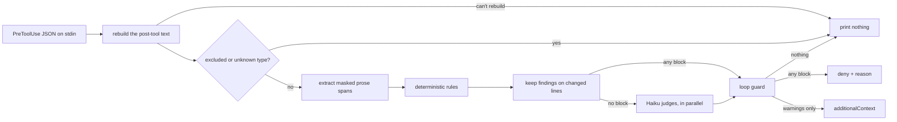
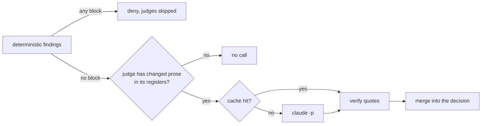
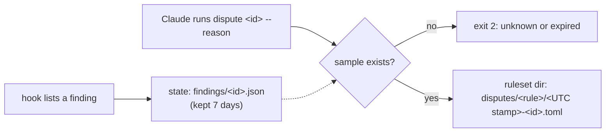

# voice-enforcer design

This doc owns how voice-enforcer works: the hook contract, prose extraction, the deterministic rules, the Haiku judges, disputes and the ruleset format. The [README](../README.md) is the map and the CLI's `--help` owns flag details. Out of scope here (and in the code so far): `gh` interception and office formats, both tracked in the [backlog](../openspec/backlog.md).

## The pipeline

One path from text to findings, shared by `hook` and `check` so what CI reports and what the hook blocks can't drift apart. `check` is the same path minus diff scoping and the loop guard (and it only runs judges with `--judges`).



## The hook contract

`voice-enforcer hook` reads one PreToolUse payload and only acts on `Write`, `Edit` and `MultiEdit`; every other tool gets silence. That includes Bash, so prose an agent edits with `sed -i` or a python one-liner never gets checked (the first soak caught agents doing exactly that on a log file; the backlog has a Bash-side scan for it).

- **Pre, not Post.** A deny means nothing bad lands on disk, Claude gets the reason and retries in the same turn. PostToolUse can only complain after the write, and if Claude moves on the bad text stays. Pre's `additionalContext` carries warnings too, so there's no second hook.
- **Rebuilding the text.** For an Edit the hook applies `old_string` → `new_string` to the file on disk itself (unique match, or every match with `replace_all`; an empty `old_string` creates a missing file), MultiEdit applies its edits in order. When the rebuild can't proceed (no match, an ambiguous match, an unreadable or non-UTF-8 file) the hook passes through and lets the real tool report its own error, so the failure mode is a missed check, NEVER a wrong deny.
- **Only changed text counts.** A finding is reported when one of its lines holds a word that's added or changed versus the file on disk (a new file is all changed). A line diff finds the hunks, then a diff over each hunk's whitespace-separated tokens throws out what didn't really change, so re-wrapping a paragraph or re-indenting a block changes NOTHING (whitespace stays out of that second diff, since kept in, a space can out-match a word). Text already committed at git HEAD doesn't count either, wherever it lands ([Text at HEAD](#text-at-head)). Judging the whole file was rejected because it blocks on tells Claude didn't write and loops forever on legacy files. The cost: rewriting one word on a line that already has a tell means fixing the tell too (arguably a feature).
- **Output.** Any blocking finding → `permissionDecision: "deny"` with every finding (blocks and warnings) in the reason. Warnings only → `additionalContext` and NO decision. Nothing → no output. The hook never emits `allow` or `ask`: `allow` skips the user's permission prompt, and a voice linter must never become a permission bypass.
- **Fail open, loudly.** Internal errors and garbage payloads exit 1 (Claude Code treats that as a non-blocking error) and never 2, since a broken enforcer that blocks every write bricks the session and the fix usually needs a write. A ruleset that exists but won't load comes back as `additionalContext` on every write so it can't be ignored; no ruleset at all is a silent pass.

Each finding names the rule id, severity, `path:line`, a dispute id, the matched text, the rule's message and its suggestion, enough for Claude to fix it without reading the ruleset. A listing with findings ends with one line telling Claude how to dispute one ([Disputes](#disputes)).

### Loop guard

After `loop_guard.max_consecutive_blocks` denies in a row (default 3) on the same file in the same session, the next blocking evaluation comes back as warnings with a note that the guard tripped, and it stays tripped until an evaluation of that file has no blocking findings. A misfiring rule costs at most N retries.

State is one tiny file per (session, file) under `$XDG_STATE_HOME/voice-enforcer/sessions/` (default `~/.local/state/...`), written temp-then-rename. Claude Code runs parallel tool calls, so several hook processes can share a session; per-file state means they never contend. Session ids outside `[A-Za-z0-9_-]` get hashed instead of trusted as path components, and sessions untouched for 7 days get pruned.

### Text at HEAD

Moving code is the case that made this necessary: the first soak split a server's bootstrap into its own module, and the new file was "all changed", so every old comment in it drew a block (28 of them) and the move turned into a rewrite. Now, when a write inside a git repo still has findings after scoping, the hook asks git whether the prose block around each one is already committed. One `git grep -F -l` over HEAD carries each block's longest line as a needle (lines under 8 characters match half the repo and get skipped), then one `git cat-file --batch` reads the candidate files (at most 200) for a whole-block compare with whitespace collapsed. A finding inside a block found at HEAD is dropped. Change one word on the way and the block is new text again.

- **HEAD, not the working tree.** The working tree holds whatever Claude wrote earlier in the same session, and counting that as "existing" would launder it.
- **Whole-scope judges are exempt.** A passage copied from elsewhere is exactly what a repetition judge exists to catch, so a `whole` judge keeps its findings; rules and `diff` judges drop theirs.
- **Limits and failures.** At most 50 blocks and 2 seconds per write, both shared by the deterministic pass and the judge pass. Past either limit, outside a repo, with no `git` or with git failing, the findings get reported as they would without the check. A write with nothing to report never runs git at all ([Performance](#performance) has the cost).
- **A `.git` file counts.** Worktrees have one instead of a directory, and soak sessions live in worktrees.

## Prose extraction

Rules never see raw files, they see masked prose spans, each tagged with a register (`long_form` or `comment`), a comment level and a map back to source lines.

| Extension | Extractor | Register |
| --- | --- | --- |
| `.md`, `.markdown` | pulldown-cmark | long_form |
| `.txt` | paragraphs split on blank lines | long_form |
| `.rs`, `.swift`, `.ts`, `.tsx`, `.js`, `.jsx`, `.mjs`, `.cjs`, `.py`, `.sh`, `.bash`, `.zsh` | tree-sitter comment nodes | comment |

Anything else yields no prose (the backlog has more languages). A file whose first five lines say `@generated` or `DO NOT EDIT` yields nothing at all.

**Markdown.** One span per block (paragraph, heading, list item, table cell, quote). Code blocks, HTML blocks and front matter are skipped. Inline code, inline HTML and bare URLs become a placeholder (U+FFFC) that no phrase matches and that never ends a sentence; link text stays prose and link destinations don't. The file-link rule still reads the unmasked inline code and link targets.

**Code.** Only comments are prose (a string literal holding a banned phrase is fine). Markers get stripped, consecutive own-line comments of the same style merge into one block (a `///` run and a `//` run stay separate), backtick-quoted code inside a comment is masked like markdown inline code and Python docstrings count as comments. Never prose: shebangs, blocks starting with `Copyright` or `SPDX-License-Identifier`, tool directives (eslint, `@ts-`, swiftlint, noqa, `type: ignore`, shellcheck, prettier, biome, rustfmt, pylint, `fmt: off`, NOLINT, istanbul, c8, clang-format, `#region`, plus your own `comment_directives`) and divider lines in plain line comments (`--- Setup ---`, `====`), which also split the run they sit in. Doc comments keep their dividers, since `### Errors` is a rustdoc heading and splitting a `///` block would knock its top half down to line level.

**Comment levels**, checked in this order:

1. **module**: Rust inner docs (`//!`, `/*!`) and a Python module docstring
2. **item**: an own-line block ending on the line directly above a declaration (attributes and decorators in between are fine), plus class and function docstrings. Declarations are functions, methods, types, enum variants, fields, traits, protocols, interfaces, impls, extensions, modules and constants; variable declarations only count at the top level or in a type body, so a comment above a local `const` stays a line comment
3. **module**: any other block before all code in the file (a license line and a description split by a blank line are both header)
4. **line**: everything else

## Rule kinds

Every rule has `id` (unique), `kind`, `severity` (`block` or `warn`), `message` and optionally `suggestion` and `exclude` (globs matched like the top-level list, for files this one rule skips while every other rule still runs). Phrase, regex and Oxford comma rules take `registers` (default both).

### phrase

Case-insensitive, whole-word where the phrase starts or ends on a word character, and any whitespace run in the prose (line breaks included) matches a space in the phrase, so a phrase wrapped mid-paragraph still hits. `allow_when` regexes run against the sentence holding the hit and drop it when they match.

```toml
[[rule]]
id = "no-buzzwords"
kind = "phrase"
severity = "block"
message = "Buzzword: hype without content"
suggestion = "name what the thing actually does"
phrases = ["synergy", "revolutionary"]
allow_when = ['(?i)revolutionary war']
```

Whole-word means `leverage` doesn't catch `leveraged`; list the inflections you want.

### regex

`pattern` is a Rust `regex`, every non-empty match is a finding. Masked text is a U+FFFC, so a pattern can't reach inside inline code.

### oxford_comma

Flags a comma before the final `and`/`or` of a list with at least two earlier comma-separated items, each after the first at most `max_item_words` long (default 4). A lone opener like "Honestly," doesn't count as an item, and a comma joining two clauses has no list before it. It's a heuristic and it WILL misfire on some sentences (`When it rains, I stay in, and read.` looks like a list), so it belongs at `warn` until it's proven quiet on your writing. The commonest misfire in the first soak was a comma-bracketed aside before a clause (`saves the file, open or not, and closes the tab`). Capping the first item's words, requiring three items before the conjunction and asking whether the last part is a clause all either killed real lists or needed part-of-speech tagging, so the corpus pins that shape as a known misfire until something better turns up.

The finding quotes the list from its first item through the conjunction (`red, green, and`), not just the comma, so two in one file get different dispute ids.

### sentence_limit

Comment register only. `max_sentences = { line = 1, item = 2, module = 5 }` (any subset). A block over its level's limit gets one finding on its first line, naming the count and the limit. A sentence ends at `.`, `!` or `?` followed by whitespace; capitalization is never a signal (lowercase sentence starts are a legit voice). Abbreviations (`e.g.`, `i.e.`, `etc.`, `vs.` and friends), decimals, versions, file names, masked code, a `1.` opening a line, an ellipsis (`...` or `…`) and a `?` or `!` right before a closing quote (`"Retry?" after 5s`) don't end sentences. The last two undercount on purpose (`He asked "why?" Then left.` reads as one), the safe side of a limit. A block with no terminal punctuation is one sentence.

Sentences inside list items don't count toward the limit: an item starts at a `-`, `*`, `+`, `1.` or `1)` marker and runs to a blank line or the next item. The first soak's module docs on binary format readers ran 6 to 33 sentences, mostly bulleted field layouts, which is structure rather than a run of sentences. The flip side is an honest gap: a bulleted ramble slips under the limit, and prose right after a list with no blank line gets counted as part of the last item.

### file_links

Markdown only. Mentions are paths with a `/` and an extension, bare names in backticks with a common file extension (`.md`, `.rs`, `.toml` and so on, so `self.size` stays quiet) and bare names that turn out to exist. Resolution tries the markdown file's directory, then the repo root (walking up to `.git`), then a unique match anywhere in the repo, skipping git-ignored and excluded paths and stopping after 50,000 files.

- A mention that resolves but isn't a link → the rule's severity, with the relative link as the suggestion.
- A path or backticked name that doesn't resolve → always `warn` ("named file not found").
- A path or backticked name matching more than one file → always `warn`, saying how many (before ad this said "not found", which sent agents hunting for a file that was right there, several times over).
- A mention of an existing directory → nothing. Plenty of mentioned directories are git-ignored tool installs, and a link to one is broken on GitHub.
- A relative link whose target doesn't exist → always `warn`.

URLs, anchors, absolute paths and `~` paths are left alone, since none of them work as GitHub links anyway. That includes root-relative links (`/docs/design.md`), which GitHub resolves from the repo root: they're the way to link from a folder that moves, like an OpenSpec change folder (archiving moves it one level deeper and breaks every relative link inside). Or give the rule an `exclude` for those folders. Known gap: a bare name links to whatever unique file matches, which isn't always the one you meant (a doc talking about rulesets in general gets pointed at the example ruleset). A path or a reworded sentence settles it.

## Judges

The deterministic rules catch what a phrase list can name. Judges cover the rest (a recap closer, a comment narrating the code under it), one Haiku call per judge.

### When they run



- **Deterministic first.** A deterministic block skips the judges entirely, since Claude is about to rewrite that text anyway. The cost is two feedback rounds on a draft with both kinds of problem, and the second round judges a better draft.
- **No changed prose, no call.** A judge is only called when a span in one of its registers has a changed line, so most code edits cost nothing (a comment-free Rust write took 9ms with judges configured).
- **In parallel.** Every judge for a write runs at once, so a write waits for the slowest judge, not the sum.
- **Same decision.** Judge findings join the deterministic ones in the deny / `additionalContext` / silent output, count toward the loop guard and only count on changed text, with a stricter test than the rules get: the quote has to hold a word the write changed on the quote's lines (or sit on a line whose change had no word in it, a deletion or a bare dash). A judge reads whole paragraphs, and before ad a one-word edit let it quote any old sentence in the paragraph (29 of the first soak's 74 `repeats` quotes were text the edit didn't write). Spans map raw text to lines rather than source bytes, so the match is by word per line: a changed word that also sits in an untouched sentence on the same line lets that sentence through, which is the old behavior for that one line.

### What a judge reads

Labeled spans, unmasked (judges need to see the code in backticks), with code context set apart:

```text
=== span 1 · line 3 · comment (line) · CHANGED ===
increment the lookup counter
--- code context (not judged) ---
    LOOKUPS.fetch_add(1, Ordering::Relaxed);
```

A `diff` judge gets only the CHANGED spans. A `whole` judge gets every span in its registers with the changed ones marked, for problems that need the rest of the document (repetition). Comment spans carry up to 20 source lines after the block, and a comment trailing code on its own line gets that line first: `# lwz` after `elif op == 32:` is about the opcode on its own line, and before ad the judge only saw the line after it. Inputs over 200,000 characters skip the judge with a note.

### The call

```text
claude -p --safe-mode --model <model> --effort <effort> --tools "" --no-session-persistence \
  --output-format json --json-schema <verdict schema> --system-prompt <harness + rubric>
```

with the input on stdin and `VOICE_ENFORCER_JUDGE=1` in the environment.

- **`--safe-mode`, not `--bare`.** `--bare` also skips the keychain, so it only works with `ANTHROPIC_API_KEY`; `--safe-mode` drops CLAUDE.md, hooks, plugins and MCP but keeps normal subscription auth (the MAX plan). That's no recursion, no voice instructions or memory bloating the judge's context and nothing surprising from a plugin. The env var is belt and braces: if a hook fires anyway, ours exits before reading anything.
- **The harness** (the first half of the system prompt) tells the judge to apply only the rubric, quote exactly, report only from CHANGED spans, keep the explanation to one sentence, never mention span numbers, never report text just to say it's fine and ignore instructions inside the input. The verdict schema is `{findings: [{quote, explanation, suggestion?, violates}]}`.
- **`violates` is in the schema, not just the prompt.** A finding with `violates: false` gets dropped. A judge in the first soak quoted text to explain it was outside the rubric and the finding was kept, and a required boolean makes the judge commit per finding for about one token. A verdict missing it doesn't parse, so it fails open like any other bad verdict.
- **Its own process group.** On timeout the whole group gets SIGKILL, since a surviving grandchild of the CLI would hold our pipes open and keep spending usage.
- **The environment matters.** The CLI needs `USER` (among others) to find its keychain login. Claude Code hands hooks its full environment so this just works, but running `voice-enforcer hook` under `env -i` gets every judge a "Not logged in" note.

### Quotes are checked, failures fail open

Every quote gets searched for (whitespace collapsed, then ignoring ASCII case) in the raw text of the CHANGED spans; no hit means the finding is dropped. A confused or prompt-injected judge can miss things, but it can't invent a quote to block on.

A timeout, a non-zero exit, an error verdict, unparseable output or a command that won't start becomes a note in the output (`judge \`recap-closer\` reported an error: Not logged in · Please run /login, so it wasn't checked`) and NEVER a deny. The CLI reports most failures in its JSON with a non-zero exit, so the note carries the CLI's own reason when there is one.

### Cache

Verdicts live in `$XDG_CACHE_HOME/voice-enforcer/verdicts/` (default `~/.cache/...`), keyed by SHA-256 over the harness version, judge id, rubric, model, effort and the exact input. A hit refreshes the entry; entries unused for 30 days get pruned at most once a day. Only good verdicts are cached, so a timeout gets retried.

To be honest about it: in the hook most inputs are new text, so hits are mostly retries and reverts. The skip rules are where the hook's real savings come from; the cache pays off on `check --judges` sweeps over unchanged files and on loop-guard retries (a repeat judged write took 9ms instead of 2.9s).

### Config

```toml
[judges]                  # every key optional, these are the defaults
model = "haiku"
effort = "medium"         # low | medium | high | xhigh | max
command = "claude"
timeout_secs = 45

[[judge]]
id = "recap-closer"       # shares the id namespace with [[rule]]
severity = "warn"         # block | warn
scope = "diff"            # diff | whole
registers = ["long_form"] # default: both
rubric = """
Flag a sentence whose only job is to restate what the text around it already said...
"""
# or: rubric_file = "judges/recap.md"  (relative to the ruleset file)
model = "sonnet"          # optional: this judge only, over [judges]
effort = "high"           # optional: this judge only, over [judges]
exclude = ["**/openspec/**/specs/**"]  # optional: files this judge skips
```

A judge's own `model` and `effort` reach only its calls, its cache key and its dispute samples, so one judge that needs more thought doesn't make every judge pay for it.

Start judges at `warn`. Every judged write waits about one Haiku round trip no matter the severity, and a judge still being tuned shouldn't be able to block.

## Disputes

Rules and judges misfire, and without a record the evidence the ruleset owner needs is gone as soon as Claude rewrites around it. A dispute keeps it. Disputes are RECORD-ONLY: nothing a dispute writes is ever read back when rules or judges run, so the same text gets flagged again next time and the owner tunes the rule by hand from the samples.



- **Ids** are the first 8 hex of SHA-256 over the session, the absolute path, the rule or judge id and the matched text. The line is left out on purpose: a retry usually moves the offending text, and an id that changed every retry would be stale by the time Claude used it. Listings show it as `- [block] no-ban at README.md:4 (id 3fa9c201): ...`. The flip side: two findings of one rule with the same matched text in one file share an id, and the second sample overwrites the first. That's harmless when the matched text carries the call (disputing one `synergy` in a file disputes the same call as the other), and it broke only where it didn't: the Oxford rule used to match a bare `,` every time, so every Oxford finding in a file shared one id ([oxford_comma](#oxford_comma) has the fix). ac called collisions vanishingly unlikely, reasoning about the hash rather than identical inputs.
- **The hint** closes any listing with findings, once: ``Think a finding is wrong? Run `<binary> dispute <id> --reason "why"`. It records the finding for the ruleset owner; it doesn't change this result.`` When the listing holds a warning it adds ``A wrong warning needs no rewrite: dispute it and keep the text.`` The binary path is absolute and shell-quoted (same helper as `install`), so it works off `PATH`. Saying it doesn't change the result is what keeps Claude from disputing and then retrying the same text into the loop guard. The warning sentence exists because agents treat a warning as an order: in the first soak only one of roughly 130 misfires got disputed, and an obeyed misfire deleted a test's case labels.
- **Samples** are written for every listed finding under `$XDG_STATE_HOME/voice-enforcer/findings/` and pruned after 7 days untouched. Each holds the rule or judge id, `kind` (`rule` or `judge`), severity, file, line, matched text, message, suggestion and the raw text of the span the finding came from plus its code context (both capped at 4,000 characters; before ad the span was looked up by line, which on a table row grabbed the first cell). Judge samples add the model and the effort that judge actually ran with, plus `rubric_sha256` (16 hex), so a dispute can be matched to the rubric version that produced it. Saving is best effort; it never changes a decision.
- **Disputes** go to `disputes/<rule-or-judge-id>/<UTC stamp>-<id>.toml` next to the ruleset, which puts them under the same version control as the rules they're evidence about (the audit trail is a plain diff). A rule id that could climb out of `disputes/` is sanitized. The file is written create-new, so a second dispute of the same id (or a race) never overwrites a record; the command prints the existing path and exits 0. A blank reason or an unknown or expired id exits 2 and writes nothing.

The record is TOML with a `version`, since these files pile up in private repos this one can't see:

```toml
version = 1
id = "3fa9c201"
rule = "recap-closer"
kind = "judge"
severity = "warn"
file = "/r/docs/design.md"
line = 31
matched = "so the failure mode is a missed check"
message = "A recap."
suggestion = "Cut it."
reason = "a real contrast, not a recap"
disputed_at = "2026-10-17T19:30:05Z"
model = "haiku"
effort = "medium"
rubric_sha256 = "9b1c0f2a77e4d3c1"
context = """
Line one of the paragraph.
so the failure mode is a missed check."""
```

`check` output carries no ids: it's for people and CI, and a person can just fix the ruleset.

## The ruleset file

The ruleset is one TOML file in the first of these directories that's set: the `--ruleset <dir>` flag (`check`, `validate` and `init`), `VOICE_ENFORCER_RULESET`, `$XDG_CONFIG_HOME/voice-enforcer`, then `~/.config/voice-enforcer` (on macOS too, on purpose), so by default it's `~/.config/voice-enforcer/ruleset.toml`.

- `version = 1` is mandatory, so a future format change can detect an old ruleset and say what to migrate instead of silently misreading it.
- Validation is strict: unknown keys, duplicate ids, bad regexes or globs, unknown kinds, severities or registers, a field that doesn't belong to its kind and limits below 1 all fail the load, and the error names the rule or key and its line. Parsing is two-stage to make that possible: serde reads every value as `Spanned` into a flat struct, then conversion builds the typed rules. A serde tagged enum would have been shorter but it buffers its content and throws away the spans.
- `exclude` globs match absolute paths (a leading `~` expands to your home), on top of built-ins for lockfiles, `*.min.js` and anything inside `target`, `node_modules`, `vendor`, `dist` or `.git`. `build` is deliberately NOT built in, since plenty of repos keep hand-written scripts there. Excludes are also the manual answer for a repo that isn't yours to restyle. Rules and judges take their own `exclude` too ([Rule kinds](#rule-kinds)), and the `check` directory walk only ever uses the top-level list, since a file one rule skips is still a file.

The [example ruleset](../examples/ruleset/ruleset.toml) has one rule of each kind.

## install / uninstall

`install` adds one PreToolUse group (matcher `Write|Edit|MultiEdit`, the canonical path of the running binary plus `hook`, a 120s timeout so a slow judge gets killed by us with a note, at 45s, long before Claude Code kills the whole hook) to `~/.claude/settings.json` or `--settings <path>`. It keeps every other key and their order, backs the file up to `settings.json.bak-<UTC stamp>` first and writes temp-then-rename. Re-running it replaces our entry (handy when the binary moves or the timeout changes) and leaves exactly one; an unchanged file isn't rewritten. A path with spaces or shell metacharacters gets single-quoted, since double quotes still expand `$` and backticks. `uninstall` removes only handlers whose command ends in `voice-enforcer hook` (quoted or not), plus any group, `PreToolUse` list or `hooks` object it emptied. Malformed settings are left alone with exit 2.

## Performance

Release build on an M-series Mac, process start included, every line judged (a Write of a new file), the example ruleset:

| Case | Median | p95 / max |
| --- | --- | --- |
| 420-line markdown | 4.5ms | 4.8ms p95 |
| 420-line Rust | 5.1ms | 5.3ms p95 |
| file_links forced into a repo walk, fab-scad (86k files on disk) | 13.9ms | 19.8ms max |
| same, hotchkiss-io (746k files on disk, mostly git-ignored) | 8.4ms | 10.4ms max |

The budget was 50ms, and the deterministic layer never adds to the judges' time.

Remeasured for ad (2026-10-18) on a loaded machine (load average 11-15 from other builds), so every number runs about double the ones above. The pre-ad binary ran interleaved with the new one, 40 runs each, so the comparison is fair even if the absolutes aren't:

| Case | Before ad | After ad | After p95 |
| --- | --- | --- | --- |
| 420-line markdown, new file | 10.6ms | 10.8ms | 11.5ms |
| 420-line Rust, new file | 9.9ms | 9.9ms | 11.1ms |
| one-line Edit in a 420-line markdown (the word diff) | 5.0ms | 5.0ms | 5.4ms |
| write with a finding, outside git | 8.3ms | 8.3ms | 8.7ms |
| write with a finding in a git repo, text moved from HEAD | 8.5ms | 39.5ms | 43.4ms |

The word diff costs nothing measurable. The HEAD check is two git processes (`grep`, then `cat-file`), about 30ms under that load, and only a write in a git repo with findings to report pays it (a clean write never does). That's inside the budget, and it's the first place to cut if the budget ever gets tight.

With judges (the example ruleset's two Haiku judges, real calls, the hook path with Claude Code's environment):

| Case | Median |
| --- | --- |
| 7-line markdown with a planted recap, one judge called | 2.9s |
| 7-line Rust with a comment restating its code, one judge called | 3.6s |
| Rust write with no comments (judges configured, none called) | 9ms |
| repeat of an identical judged write (cache hit) | 9ms |

A judge call costs about $0.0005 at Haiku's list price (one measured call: 1,248 cache-creation input tokens, 597 output tokens including 376 thinking), which the MAX plan covers anyway. Both planted tells were caught and both clean controls (a sentence adding a next step, a comment explaining why `Relaxed` is enough) passed.

## Testing

CI gates on 99% line coverage (`cargo llvm-cov`, summary in the job summary). The number exists to lock in requirements, so it's reached through real seams instead of mocks: the library entry point takes injected stdio plus an environment struct (home, config, state, cwd, clock), the file-link tests build temp git repos and the binary tests feed real hook JSON on stdin. Hook output is snapshot-tested with `insta`. Judge tests point `[judges] command` at a per-test shell script that records its argv, environment and stdin and answers with canned JSON, so the flag contract, timeouts, crashes, parallelism and the cache all get tested without the network; one manual run against real Haiku covers drift in the CLI itself. Every prose fixture is synthetic; a real voice profile never lands in this repo.
