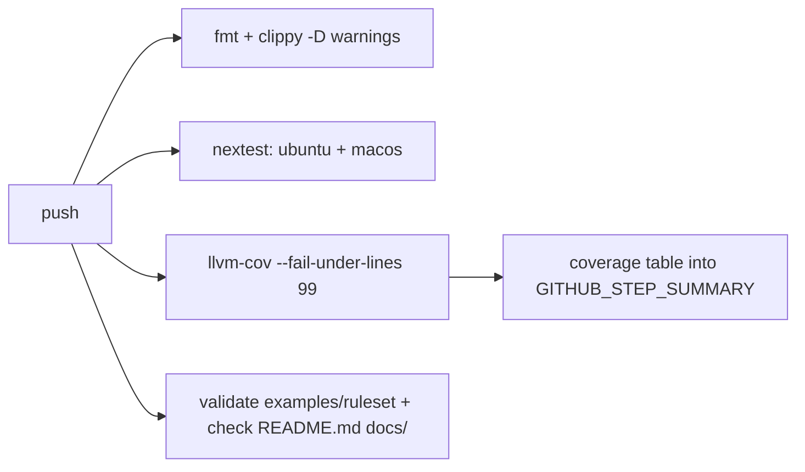
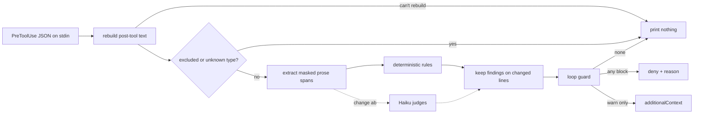

# Design

## Context

Greenfield repo, motivation in proposal.md (Why). The constraints that shape the approach:

- The hook runs synchronously on EVERY Write/Edit/MultiEdit, so the deterministic path has to cost milliseconds (no network, no subprocess). The Haiku judges in change ab will dominate latency, this layer can't add to it.
- Claude Code's PreToolUse contract: JSON on stdin; on stdout a `hookSpecificOutput` carrying `permissionDecision` (`allow` / `deny` / `ask` / `defer`), `permissionDecisionReason` and `additionalContext`. Exit 2 blocks no matter what JSON was printed, any other non-zero exit is a non-blocking error.
- The ruleset is private and lives outside the repo, so the binary has to be complete and testable with zero voice baked in.
- 99% line coverage is the CI gate, which shapes how the code is cut (below).

## Goals / Non-Goals

**Goals:**

- One pipeline for `hook` and `check`. `check` is the same path minus diff scoping and the loop guard, so what CI reports and what the hook blocks can't drift apart.
- A finding source boundary that change ab's judges plug into: same finding shape, same severity semantics, same output formatting. Judges add a source, they don't fork the pipeline.
- Deterministic evaluation of a typical file (a few hundred lines) in under 50ms wall clock including process start.

**Non-Goals:**

- Auto-fixing prose. Findings tell Claude what's wrong and Claude rewrites; a mechanical rewrite of prose produces exactly the generic voice this tool exists to kill.
- PostToolUse. Pre covers both block and warn (below).
- Windows. Paths and XDG dirs assume macOS / Linux; it may work, nobody's testing it.

## Decisions

### PreToolUse, not PostToolUse

Pre denies BEFORE the text lands: nothing bad sits on disk, Claude gets the reason and retries in the same turn. Post can only complain after the write, and if Claude moves on (or the session ends) the bad text stays.

- Cost: we reimplement Edit and MultiEdit's string-replace semantics to rebuild the post-tool text. It's small and exact (unique match or `replace_all`), and when our rebuild can't proceed we pass through and let the tool report its own error.
- Alternative considered: Pre for blocks plus Post for warnings. Rejected, Pre's `additionalContext` carries warnings without a second hook or shared state between the two.

### Never emit `allow`

`allow` skips the user's permission prompt. A voice linter must never become a permission bypass, so warnings ride on `additionalContext` with no `permissionDecision` at all and Claude Code's normal flow decides.

### Diff scoping by changed lines

Findings count only when they touch a line that's added or changed versus the on-disk file (line diff via `similar`).

- Whole-file evaluation was rejected: it blocks on tells Claude didn't write and loops forever on legacy files.
- Diffing findings as a multiset (before vs after) was rejected: it can't tell WHICH of two identical occurrences is new.
- The rule is "you touched the line, it's yours." Cheap and easy to explain; the cost is boy-scouting: rewriting one word on a line with an old tell means fixing the tell too (acceptable, arguably a feature).
- Change ab adds whole-file judges (repetition) on purpose; scope becomes a per-source property then, not a global one.

### Rules are a typed enum

The ruleset becomes a typed enum on `kind`, with unknown keys rejected. A typo in a key fails `validate` loudly instead of silently disabling a rule (the failure mode that matters, since a disabled rule looks exactly like a clean draft). Built two-stage (serde into a flat struct of `Spanned` values, then conversion), because a serde tagged enum buffers its content and loses the spans that let errors name a line. Regex-only rules were rejected because the Oxford comma, sentence limit and file link checks need real logic, not patterns.

### Extraction emits masked prose spans

Rules never see raw files. Every extractor produces spans holding masked text, a register (long-form / comment), a comment level and an offset map back to source lines.

- Code: `tree-sitter` with six grammars (Rust, Swift, TypeScript/TSX, JavaScript, Python, Bash). Comment nodes come straight from the AST, docstrings are detected by position (first statement of a module / class / function), and item attachment is "the next named sibling is a declaration with no blank line between" (attributes and decorators skipped). Regex comment stripping was rejected because `//` inside a URL string and nested block comments break it.
- Markdown: `pulldown-cmark` with its offset iterator, GFM tables and metadata-block parsing (front matter skipped). Chosen over tree-sitter-markdown because it's mature, pure Rust and offset-exact.
- Masking: inline code and link destinations become placeholders that no phrase can match and that never end a sentence, with the offset map keeping line numbers exact. The file-link rule reads the unmasked mentions from the same span.

### Ruleset format: TOML with a version

TOML because a ruleset is hand-annotated (the WHY behind each banned phrase is worth a comment beside it) and it's Rust-native. YAML was rejected over indentation footguns and the deprecated `serde_yaml`. `version = 1` is mandatory so a future format change can detect an old ruleset and say what to migrate. Shape:

```toml
version = 1
exclude = ["~/workspace/their-repo/**"]
comment_directives = ["^lint:allow"]

[loop_guard]
max_consecutive_blocks = 3

[[rule]]
id = "no-marketing"
kind = "phrase"
severity = "block"
registers = ["long_form", "comment"]
phrases = ["seamless", "best-in-class", "leverage"]
allow_when = []
message = "Marketing adjective"
suggestion = "Say what it actually does"

[[rule]]
id = "comment-length"
kind = "sentence_limit"
severity = "warn"
max_sentences = { line = 1, item = 2, module = 5 }
```

One file for now. If a big phrase list makes it unwieldy, splitting into `rules.d/*.toml` is a backlog item, not a v1 feature.

### Loop guard state is one file per (session, path)

State lives at `$XDG_STATE_HOME/voice-enforcer/sessions/<session_id>/<sha256(path)>`, holding the consecutive-deny count. Claude Code runs parallel tool calls, so several hook processes for one session can run at once, and a single shared JSON file would race. Per-path files never contend, writes are temp-file-plus-rename and pruning deletes session dirs untouched for 7 days.

### Fail open, loudly

Internal errors exit 1 (non-blocking) and NEVER 2: a broken enforcer that denies every write bricks the session, and the fix usually needs a write. A ruleset that exists but won't load comes back as `additionalContext` so it's visible every time, not swallowed. No ruleset at all is a silent pass, since that's just "not configured."

### The binary is a thin shim over the library

`main.rs` calls one library entry point with injected stdin, stdout, stderr and an environment struct (home, config dir, state dir, cwd, clock). Everything else is in-process testable without mocking, which is how 99% stays reachable. `main.rs` is excluded from coverage via `--ignore-filename-regex`, and a handful of `assert_cmd` tests run the real binary end to end with hook JSON on stdin. Hook output is snapshot-tested with `insta`, and file-link tests use temp git repos.

### `install` edits settings.json surgically

`serde_json` with `preserve_order` so key order survives and the diff stays minimal. The command is the canonicalized absolute path of the running binary plus `hook`, with a 30s timeout (the deterministic path needs a fraction of that, change ab raises it for the judges). Before any write the original is copied to `settings.json.bak-<YYYYMMDDHHMMSS>`. Our entries are identified by a command ending in `voice-enforcer hook`, which is also what `uninstall` matches.

### CI



The dogfood job runs `check` with the example ruleset over the repo's own docs. The example rules are neutral, but they include `file_links`, so the docs have to link the files they name.

### Pipeline



## Risks / Trade-offs

- [Oxford comma and sentence splitting are heuristics, they WILL misfire on some prose] → each is its own rule with its own severity (start at `warn` and promote once it's quiet), the scenarios in specs/deterministic-rules become the regression suite and every misfire found later gets added as a fixture.
- [Unique-basename resolution in file_links walks the repo, which is slow in a big monorepo] → it runs only after relative and root resolution fail, honors `.gitignore` and the excludes, and stops after 50k entries, treating the mention as unresolved and saying so in the warning.
- [tree-sitter grammar crates lag the core ABI at different rates (the Swift grammar is community-maintained)] → pin versions that agree; if Swift can't match, it slips to the backlog rather than holding the change.
- [Our Edit rebuild could disagree with the real tool in some edge case] → any rebuild we're unsure of passes through, so the failure mode is a missed check, never a wrong deny.
- [Rules that block on prose Claude was explicitly asked to write (quoting a banned phrase in a doc ABOUT banned phrases)] → `allow_when` and path excludes cover the known cases, and the loop guard caps the damage of an unknown one at N retries.

## Migration Plan

Greenfield, so this is rollout, not migration:

1. `cargo install --path .` (or `--git`).
2. `voice-enforcer init` writes the example ruleset to `~/.config/voice-enforcer/`.
3. Replace it with a real ruleset kept in a private repo. Symlinking `~/.config/voice-enforcer` into that repo keeps the ruleset versioned there and invisible to this one.
4. `voice-enforcer validate`, then `voice-enforcer install`.

Rollback is `voice-enforcer uninstall`, or restoring the `settings.json.bak-*` it wrote.

## Open Questions

- A `check --diff <rev>` mode that judges only lines changed against a base branch, for CI on repos with legacy prose. Deferrable, the whole-file `check` covers v1.
