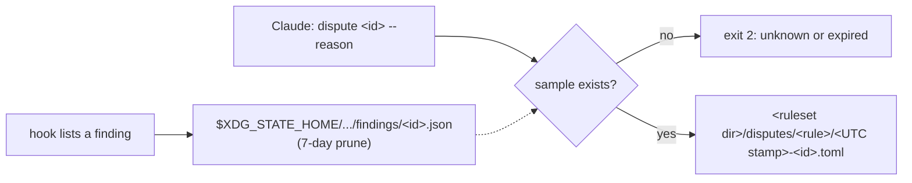

# Design

## Context

Motivation is in proposal.md (Why). What exists: the hook lists findings (deterministic and judge alike) as `- [severity] id at path:line: "matched" - message (suggestion: ...)` lines in a deny reason or `additionalContext`, the loop guard already keeps per-session state under `$XDG_STATE_HOME/voice-enforcer` with temp-then-rename writes and a 7-day prune, and every finding traces back to a prose span (the hook has the spans in hand when it builds the listing). `install` already knows how to shell-quote the binary's path, and `setup` already formats UTC timestamps.

The decision that shapes everything: disputes are RECORD-ONLY (chotchki's call). Nothing a dispute writes is ever read back by the hook, so there's no feedback loop to get wrong.

## Goals / Non-Goals

**Goals:**

- A dispute captures enough to fix the rule without going back to the session: what fired, on what text, with what explanation, in what surrounding prose and why Claude thinks it's wrong.
- The id Claude sees in a reason is the id it disputes, even after a retry moved the text.
- Nothing about disputes can change a hook decision.

**Non-Goals:**

- Feedback into rules or judges (suppression, counter-examples).
- Ids on `check` output, or a listing command.

## Decisions

### Ids hash what stays put across retries

`id = first 8 hex of SHA-256(session_id, absolute path, rule or judge id, matched text)`. The line is left out on purpose: Claude's retry usually moves the offending text, and an id that changed on every retry would make the one in the reason stale by the time Claude acts on it. 32 bits scoped to one session and one file makes a collision vanishingly unlikely; if one happened, the later sample overwrites the earlier one and the dispute records the wrong finding's sample (an honest gap, not a decision change).

The listing becomes `- [block] no-leverage at README.md:4 (id 3fa9c201): "leverage" - ...`.

### One hint line, not per-finding instructions

When a listing has findings, its last line is:

```text
Think a finding is wrong? Run `/abs/path/voice-enforcer dispute <id> --reason "why"`. It records the finding for the ruleset owner; it doesn't change this result.
```

Once per listing keeps the cost flat no matter how many findings there are. The absolute path (shell-quoted with the same helper `install` uses) means it works even when the binary isn't on `PATH`. Saying outright that it doesn't change the result is what stops Claude from disputing and then retrying the same text into the loop guard.

### Samples live in state, disputes live in the ruleset



Samples are internal and short-lived (JSON, overwritten when the same finding comes back, pruned like the guard's session state). Disputes are the durable record and belong with the rules they're evidence about, which also puts them under whatever version control holds the ruleset (the audit trail, as a plain diff).

A sample holds the rule or judge id, `kind` (`rule` or `judge`), severity, absolute file path, line, matched text, message, suggestion, the raw text of the span holding the finding's line and that span's code context, both capped at 4,000 characters so a huge paragraph can't bloat the record. Judge samples add the model, the effort and `rubric_sha256` (the first 16 hex of the rubric's hash), so a sample can be matched to the rubric version that produced it after the rubric moves on. `kind` comes from whether the finding's id is a judge id in the loaded ruleset (the two share one namespace).

### The dispute file

TOML, like the ruleset, so it reads cleanly in a diff and `toml` is already a dependency:

```toml
version = 1
id = "3fa9c201"
rule = "recap-closer"
kind = "judge"
severity = "warn"
file = "/Users/someone/project/docs/design.md"
line = 31
matched = "so the failure mode is a missed check, NEVER a wrong deny."
message = "This closing clause only restates the preceding point..."
reason = "A genuine contrast naming the design's asymmetry, not a recap."
disputed_at = "2026-10-17T22:14:05Z"
model = "haiku"
effort = "medium"
rubric_sha256 = "9b1c0f2a77e4d3c1"
context = """..."""
```

`version` exists for the same reason the ruleset has one: these files accumulate in private repos this repo can't see, so a later format change has to be detectable. Writing is temp-then-rename and refuses to overwrite: if any `*-<id>.toml` already exists in that rule's folder, the command prints its path and exits 0.

### Shared helpers move out of `setup`

`utc_stamp` (now joined by an RFC 3339 form for `disputed_at`) moves to a small `clock` module and the shell-quoting half of `install`'s command builder becomes a shared helper, so `dispute`'s file names, its timestamps and the hook's hint reuse code that's already tested instead of growing copies.

### Pruning

The findings dir gets the same 7-day prune as the guard's sessions, run from the same place in the hook, by file mtime (a sample re-saved on a retry gets a fresh mtime).

## Risks / Trade-offs

- [Record-only means the same misfire blocks again] → by design; the hint says so up front and the loop guard still caps the retries. The value is in the record, and the owner fixes the rule.
- [Claude disputes liberally to make a finding go away] → it can't make anything go away, so there's nothing to gain beyond writing a file; every dispute shows up in the ruleset repo's diff.
- [Samples hold prose from whatever Claude was writing] → they live in the user's own state dir for at most 7 days, and disputes land only in the user's own ruleset dir. Neither goes anywhere else.
- [A dispute arrives after the sample expired] → exit 2 with a message that says so; the finding's text is still in the transcript if it matters.

## Migration Plan

Nothing to migrate: the first `dispute` creates `disputes/` in the ruleset dir. Re-running `install` isn't needed (the hook entry doesn't change).
